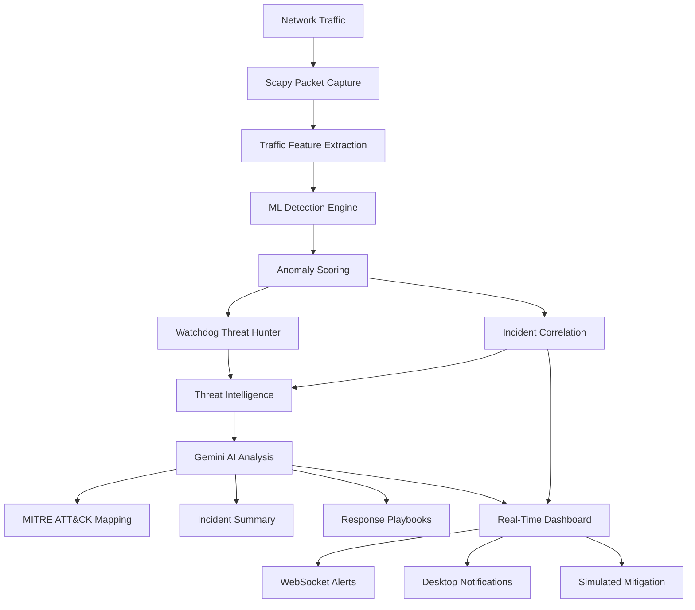
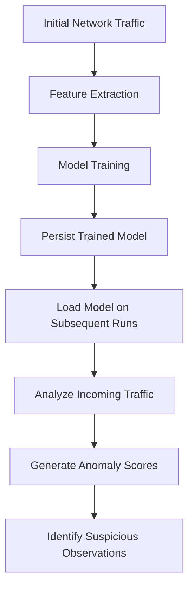

# 🛡️ NetSentinel
### Intelligent Network Threat Detection, Investigation & Response

**Your AI-powered network security co-pilot.**

NetSentinel is an intelligent network security platform that combines Machine Learning, Generative AI, autonomous threat hunting, and real-time network traffic analysis to identify, investigate, and respond to suspicious network activity.

Traditional network monitoring systems often overwhelm security teams with raw logs, isolated alerts, and predefined detection rules. NetSentinel takes a different approach: it learns normal network behavior, identifies deviations, correlates suspicious events, investigates potential threats, and translates technical findings into actionable security intelligence.

It doesn't just monitor your network. It learns its behavior, hunts for anomalies, builds incident narratives, and helps security analysts understand what might be happening.

---

## 📑 Table of Contents

- [Overview](#-overview)
- [The Problem](#-the-problem)
- [Our Approach](#-our-approach)
- [Key Features](#-key-features)
- [System Architecture](#-system-architecture)
- [Detection Pipeline](#-detection-pipeline)
- [Machine Learning Engine](#-machine-learning-engine)
- [AI Intelligence Layer](#-ai-intelligence-layer)
- [Watchdog: Autonomous Threat Hunter](#-watchdog-autonomous-threat-hunter)
- [Threat Intelligence](#-threat-intelligence)
- [Incident Correlation](#-incident-correlation)
- [Attack Simulation](#-attack-simulation--digital-twin)
- [Mitigation Capabilities](#-mitigation-capabilities)
- [Technology Stack](#-technology-stack)
- [Installation & Setup](#-installation--setup)
- [Configuration](#-configuration)
- [API Overview](#-api-overview)
- [Security Considerations](#-security-considerations)
- [Limitations & Future Improvements](#-limitations--future-improvements)
- [Contributing](#-contributing)

---

## 🌐 Overview

Modern cyber threats are increasingly difficult to detect using conventional signature-based monitoring alone.

Attackers can exploit legitimate network protocols, gradually exfiltrate sensitive information, move laterally across infrastructure, and deliberately keep their activity below conventional detection thresholds.

NetSentinel aims to address these challenges through a hybrid intelligence architecture.

It combines three complementary approaches:

| Layer | Responsibility |
|---|---|
| Machine Learning | Detect deviations from learned network behavior |
| Generative AI | Investigate, explain, and contextualize suspicious activity |
| Autonomous Agents | Proactively investigate behavioral threats and recommend actions |

The result is a unified security workflow that transforms raw network activity into structured, understandable security intelligence.

## 🚨 The Problem

Traditional network security monitoring has several limitations:

**1. Dependence on predefined signatures**

Signature-based systems primarily detect threats they already know about. Unusual or previously unseen behavioral patterns can go unnoticed.

**2. Alert fatigue**

Security analysts frequently deal with large volumes of disconnected alerts, making it difficult to distinguish meaningful threats from harmless deviations.

**3. Lack of contextual understanding**

A suspicious IP address or unusual traffic spike does not necessarily explain what happened, why it matters, or what should be done next.

**4. Limited proactive investigation**

Conventional monitoring workflows often depend on analysts manually investigating suspicious events rather than actively searching for subtle attack patterns.

**5. Difficult incident interpretation**

Raw packet information, network events, and anomaly scores are not particularly useful to someone who needs to make an immediate security decision.

NetSentinel attempts to bridge these gaps by combining behavioral detection with contextual AI-driven investigation.

---

## 🧠 Our Approach

NetSentinel follows a hybrid detection and investigation architecture.

Instead of asking a single AI model to perform every security operation, responsibilities are divided across specialized components.

- An ML engine learns network behavior and detects statistical anomalies.
- A threat intelligence module enriches suspicious connections with external reputation data.
- An AI analysis layer investigates detected events and generates human-readable explanations.
- An autonomous agent searches for subtle behavioral threats.
- An incident correlation engine groups related events into meaningful security incidents.

This separation is intentional.

Critical detection mechanisms remain measurable and testable, while Generative AI is used where contextual reasoning and natural-language interpretation provide additional value.

---

## ✨ Key Features

### 1. Intelligent Behavioral Anomaly Detection

NetSentinel uses an unsupervised Machine Learning approach based on **Isolation Forest**.

Rather than depending entirely on predefined attack signatures, the model learns patterns from network traffic and identifies observations that deviate from the learned baseline.

Key capabilities:

- Unsupervised anomaly detection.
- Behavioral network profiling.
- Feature-based traffic analysis.
- Anomaly scoring.
- Adaptive model persistence.
- Detection of unusual network behavior without requiring labeled attack examples.

### 2. AI-Powered Incident Analysis

Detection alone is not enough. Security analysts need to understand what an alert actually means.

NetSentinel integrates Google's Gemini API to provide contextual analysis of suspicious network activity.

The AI intelligence layer can:

- Generate human-readable incident summaries.
- Explain suspicious network behavior.
- Map detected activities to the MITRE ATT&CK framework.
- Generate step-by-step incident response playbooks.
- Provide contextual recommendations for investigation and response.

### 3. Autonomous Threat Hunting — Watchdog

**Watchdog** is NetSentinel's autonomous AI threat-hunting agent.

Statistical anomaly detection is useful for identifying unusual observations, but not every malicious activity produces an obvious statistical anomaly.

Watchdog adds an investigation layer that actively examines suspicious behavioral patterns.

Its intended investigation targets include:

- Potential lateral movement.
- Low-and-slow data exfiltration.
- Suspicious communication patterns.
- Subtle behavioral deviations.
- Potentially coordinated malicious activity.

Rather than simply waiting for an anomaly score to cross a threshold, Watchdog investigates contextual signals and helps surface threats that deserve additional attention.

### 4. Real-Time Threat Intelligence

NetSentinel integrates with **AbuseIPDB** to enrich network observations with external IP reputation information.

The integration helps identify connections involving IP addresses previously reported for suspicious or malicious activity.

This provides an additional source of evidence alongside behavioral anomaly detection.

### 5. Incident Correlation & Threat Storytelling

Individual alerts rarely tell the complete story.

NetSentinel includes an incident correlation mechanism that groups related anomalous events into a unified incident.

Instead of presenting isolated alerts, the system can expose a chronological threat narrative.

The resulting Threat Story helps users understand:

- What suspicious events occurred.
- How related events are connected.
- Which network entities were involved.
- How the incident developed over time.
- What actions may be appropriate next.

### 6. Real-Time Alerting

NetSentinel provides multiple notification mechanisms:

- **WebSocket:** Pushes real-time security events to the web dashboard.
- **Desktop Notifications:** Uses Plyer to deliver native operating-system notifications.

This allows users to monitor suspicious activity without constantly refreshing the dashboard.

### 7. Attack Simulation & Digital Twin

Testing security detection systems against controlled attack scenarios is essential.

NetSentinel includes an attack simulation API that allows users to generate controlled traffic patterns against the detection engine.

Supported demonstration scenarios include:

- Port scanning.
- UDP flooding.
- Other configured suspicious traffic patterns.

The simulation environment helps demonstrate how the detection pipeline responds to different traffic behaviors without requiring a real attacker.

### 8. Simulated Mitigation

NetSentinel includes a mitigation API that demonstrates response actions against suspicious IP addresses.

Available simulated actions include:

- Blocking an attacker IP.
- Redirecting an attacker IP to a honeypot.

These capabilities demonstrate how detection can be connected to response workflows.

**Important:** These are simulated mitigation actions, not a claim of automatic enforcement by a production firewall or network appliance.

### 9. Real-Time Packet Analysis

NetSentinel uses **Scapy** to capture and analyze network traffic at the packet level.

This enables the system to inspect network activity, extract relevant information, and transform observations into features for downstream analysis.

### 10. Adaptive Model Persistence

NetSentinel supports training a custom ML model using the network's observed traffic on its first run.

The trained model is persisted so subsequent executions can reuse the learned baseline instead of starting from scratch.

This provides a foundation for network-specific behavioral profiling.

---

## 🏗️ System Architecture

NetSentinel follows a modular architecture in which packet capture, detection, investigation, and response operate as distinct stages.



*Conceptual architecture illustrating the major system components and their interactions.*

---

## 🔍 Detection Pipeline

The detection pipeline transforms raw network traffic into actionable security information.

**Stage 1 — Traffic Capture**

Scapy captures network packets and extracts relevant traffic information.

**Stage 2 — Feature Extraction**

Relevant network observations are transformed into structured features suitable for machine learning.

**Stage 3 — Behavioral Analysis**

The Isolation Forest model evaluates observations against the learned network baseline.

**Stage 4 — Anomaly Identification**

Suspicious observations receive anomaly scores and are passed to downstream investigation components.

**Stage 5 — Context Enrichment**

Relevant observations are enriched with external threat intelligence and contextual information.

**Stage 6 — Incident Investigation**

The AI analysis layer and Watchdog investigate suspicious activity and generate contextual intelligence.

**Stage 7 — Alerting & Response**

Correlated incidents are exposed through the dashboard, notifications, and available response APIs.

---

## 🤖 Machine Learning Engine

### Isolation Forest

NetSentinel uses Isolation Forest for unsupervised anomaly detection.

Isolation Forest works by recursively partitioning the feature space. Anomalous observations tend to be isolated with fewer partitions than ordinary observations.

This makes it useful for identifying unusual network behavior without requiring a fully labeled dataset of attacks.

The model operates on extracted network traffic features.

### Why Unsupervised Learning?

In real-world network environments, obtaining comprehensive labeled datasets is difficult.

New attack patterns also emerge continuously.

An unsupervised approach provides a way to learn normal behavioral characteristics and flag deviations that deserve investigation.

### Model Lifecycle



The model's output is an anomaly signal, not definitive proof of malicious activity. Additional contextual investigation is necessary.

---

## 🧩 AI Intelligence Layer

NetSentinel integrates Google's Gemini API to transform technical network observations into understandable security intelligence.

Rather than using an LLM as the primary packet-level detection mechanism, the system uses it for contextual analysis and decision support.

### Incident Summarization

Converts technical observations into concise, human-readable explanations.

### MITRE ATT&CK Mapping

Associates suspicious activities with relevant tactics and techniques from the MITRE ATT&CK knowledge base.

### Response Playbook Generation

Generates actionable investigation and response recommendations for identified incidents.

### Contextual Reasoning

Combines relevant event information to provide a more understandable picture of suspicious activity.

---

## 🐕 Watchdog: Autonomous Threat Hunter

Watchdog is NetSentinel's proactive AI investigation component.

Its purpose is to complement statistical anomaly detection by examining suspicious behavioral patterns that may not independently trigger traditional anomaly thresholds.

### Why Watchdog?

Consider a scenario in which a device gradually increases outbound data transfers over several hours.

Each individual transfer may appear normal.

However, the combined behavior might indicate potential low-and-slow data exfiltration.

A purely statistical detection mechanism may struggle to identify the broader pattern.

Watchdog is designed to investigate such contextual signals and surface potentially suspicious behavior.

### Investigation Objectives

- Examine suspicious behavioral patterns.
- Identify potentially related network activities.
- Investigate subtle or persistent deviations.
- Generate contextual threat assessments.
- Support analyst decision-making.

Watchdog complements the ML engine; it does not replace deterministic detection or human security review.

---

## 🌍 Threat Intelligence

NetSentinel integrates AbuseIPDB to provide external IP reputation information.

The integration enriches suspicious network connections with additional contextual evidence.

This helps distinguish between:

- Connections involving known suspicious IP addresses.
- Unfamiliar but potentially legitimate network endpoints.
- Connections that warrant further investigation.

External reputation information is treated as an additional signal rather than definitive evidence of compromise.

---

## 📖 Incident Correlation & Threat Storytelling

A collection of individual alerts can be difficult to interpret.

NetSentinel attempts to transform related observations into a unified incident narrative.

The incident correlation component groups related anomalous events and exposes a chronological Threat Story through its API.

This allows analysts to move from:

**Individual alerts → Related events → Unified incident → Investigation context → Response recommendations**

The objective is to reduce the cognitive overhead involved in understanding network activity.

---

## ⚔️ Attack Simulation & Digital Twin

NetSentinel includes an API-driven simulation environment for demonstrating detection capabilities.

### Supported Scenarios

| Scenario | Purpose |
|---|---|
| Port Scan | Demonstrates suspicious port enumeration |
| UDP Flood | Demonstrates unusually high UDP traffic volume |
| Additional configured patterns | Tests detection behavior against other traffic scenarios |

The simulation mechanism allows developers to validate the detection pipeline under controlled conditions.

It also provides a repeatable environment for demonstrations and testing.

Only use the simulator against systems and networks you own or are explicitly authorized to test.

---

## 🛠️ Technology Stack

| Category | Technologies |
|---|---|
| Programming Language | Python |
| Packet Analysis | Scapy |
| Machine Learning | Scikit-learn |
| Anomaly Detection | Isolation Forest |
| Generative AI | Google Gemini API |
| Threat Intelligence | AbuseIPDB |
| Model Persistence | Joblib |
| Backend / API | Python API services |

---

## 🚀 Installation & Setup

### Prerequisites

- Python 3.10 or compatible project-supported version.
- Git.
- Access to a network interface you are authorized to monitor.
- Google Gemini API key.
- AbuseIPDB API key.

### 1. Clone the Repository

```bash
git clone https://github.com/Faham-from-nowhere/NetSentinel.git

cd NetSentinel
```

### 2. Create a Virtual Environment

```bash
python -m venv venv
```

Activate it:

**Windows**

```powershell
venv\Scripts\activate
```

**Linux / macOS**

```bash
source venv/bin/activate
```

### 3. Install Dependencies

If the repository contains a requirements file:

```bash
pip install -r requirements.txt
```

### 4. Configure Environment Variables

Create a `.env` file in the project root.

```env
GEMINI_API_KEY=your_gemini_api_key
ABUSEIPDB_API_KEY=your_abuseipdb_api_key
```

Add any additional environment variables required by your implementation.

### 5. Launch NetSentinel

Use the actual application entry point and startup command defined in the repository.

```bash
python main.py
```

**Note:** Packet capture may require elevated permissions depending on your operating system and network configuration.

---

## ⚙️ Configuration

NetSentinel requires external API credentials for its AI analysis and threat intelligence integrations.

| Configuration | Description |
|---|---|
| GEMINI_API_KEY | Authenticates requests to Google Gemini |
| ABUSEIPDB_API_KEY | Authenticates AbuseIPDB reputation lookups |
| Network Interface | Defines the network interface used for packet capture |
| Model Persistence Path | Location used to store the trained anomaly detection model |

Use environment variables rather than hardcoding credentials.

---

## 🔌 API Overview

NetSentinel exposes API functionality for interacting with its detection, investigation, simulation, and mitigation components.

Major functional groups include:

| API Component | Purpose |
|---|---|
| Network Monitoring | Access network monitoring and packet-analysis functionality |
| Anomaly Detection | Process and evaluate suspicious network observations |
| Incident Management | Retrieve correlated incidents and Threat Stories |
| AI Analysis | Generate incident explanations and response playbooks |
| Threat Intelligence | Enrich suspicious IP addresses |
| Attack Simulation | Generate controlled port-scan and UDP-flood scenarios |
| Mitigation | Demonstrate simulated IP blocking and honeypot redirection |
| Real-Time Alerts | Deliver live events through WebSockets |

Refer to the actual backend route definitions for endpoint paths, HTTP methods, request schemas, and response formats.

---

## 🔐 Security Considerations

NetSentinel is a security research and demonstration platform. Its components should be deployed with appropriate operational safeguards.

Important considerations:

- Packet capture should only be performed on authorized networks.
- API credentials must be stored securely.
- LLM-generated analysis should be treated as advisory rather than authoritative.
- External IP reputation information may be incomplete or outdated.
- Simulated mitigation should not be confused with actual firewall enforcement.
- Network traffic may contain sensitive information and should be handled accordingly.
- Production deployment requires authentication, authorization, input validation, secure logging, and appropriate access controls.

---

## 🚧 Limitations & Future Improvements

NetSentinel is an evolving project. Several areas offer opportunities for further development.

### 1. Improved Detection Evaluation

- Benchmark against established intrusion detection datasets.
- Evaluate precision, recall, and false-positive rates.
- Test detection robustness across different network environments.
- Investigate model drift and baseline adaptation.

### 2. Advanced Behavioral Analysis

- Temporal sequence analysis.
- Detection of coordinated multi-stage attacks.
- Improved lateral movement identification.
- More sophisticated low-and-slow exfiltration detection.

### 3. Agentic Investigation

- Multi-stage autonomous threat investigation.
- Improved evidence gathering.
- Structured agent tool-calling.
- Human approval for high-impact response actions.

### 4. Production-Grade Response

- Integration with actual firewall systems.
- Automated containment with explicit authorization.
- SIEM and SOAR integrations.
- More granular response policies.

### 5. Explainable Security Intelligence

- Evidence-backed incident explanations.
- Confidence and uncertainty reporting.
- More precise MITRE ATT&CK mapping.
- Traceable AI-generated recommendations.

### 6. Scalability & Performance

- High-throughput packet processing.
- Asynchronous event processing.
- Distributed monitoring.
- Efficient long-term event storage.

---

## 🤝 Contributing

Contributions, suggestions, and discussions are welcome.

If you're interested in network security, behavioral anomaly detection, machine learning, or autonomous threat investigation, feel free to explore the repository and propose improvements.

1. Fork the repository.
2. Create a feature branch.
3. Implement and test your changes.
4. Submit a pull request describing the improvement.

---

## 💡 Design Philosophy

NetSentinel was built around a simple idea:

**Detection without context creates alerts. Intelligence without evidence creates uncertainty. Security needs both.**

The project explores how traditional machine learning, Generative AI, and autonomous agents can work together to make network security more proactive, interpretable, and actionable.

Rather than treating AI as a replacement for conventional security mechanisms, NetSentinel uses it as an additional intelligence layer that helps turn suspicious network activity into meaningful security decisions.

---

<p align="center">
  <b>NetSentinel — See Beyond the Noise. Detect. Investigate. Respond.</b>
</p>
